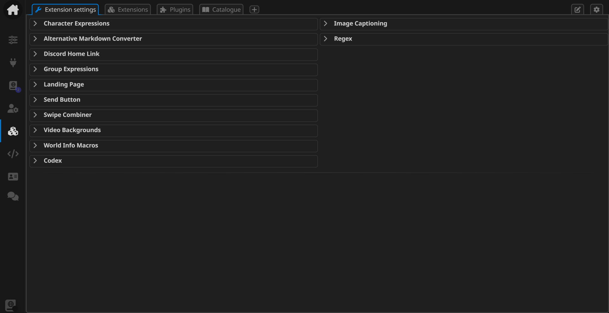
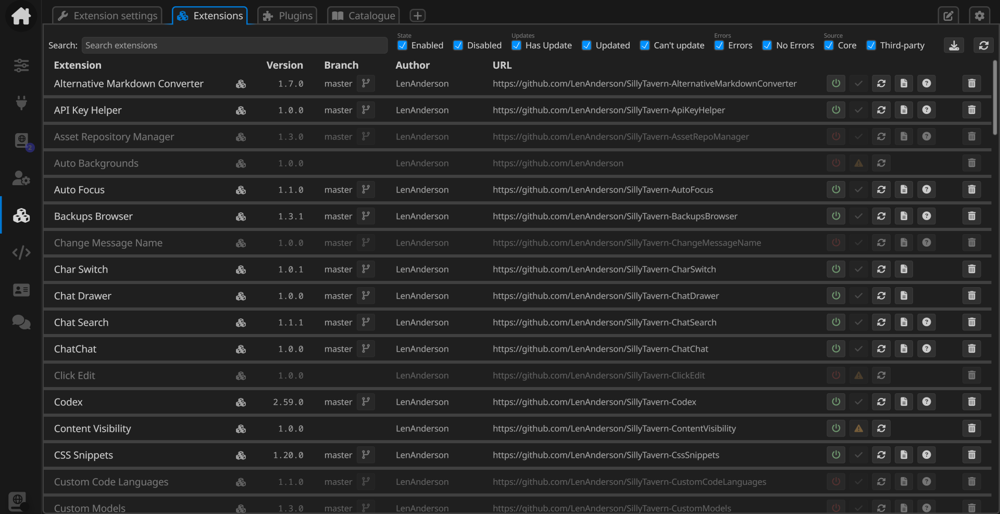
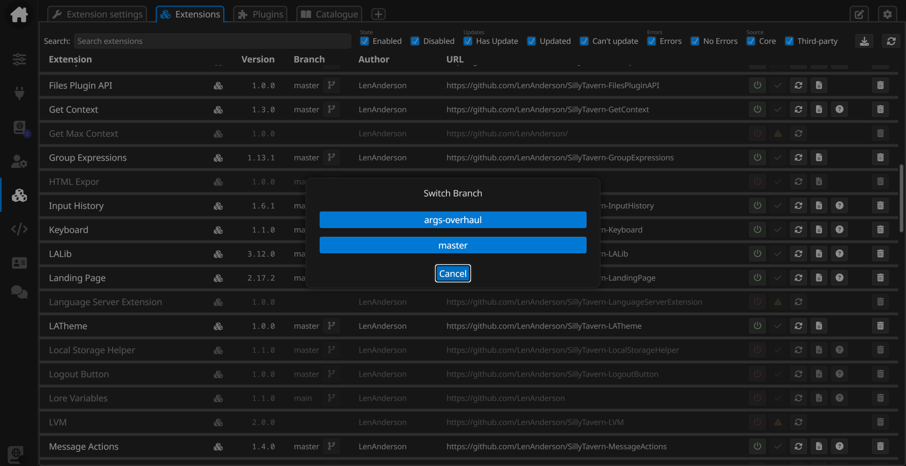
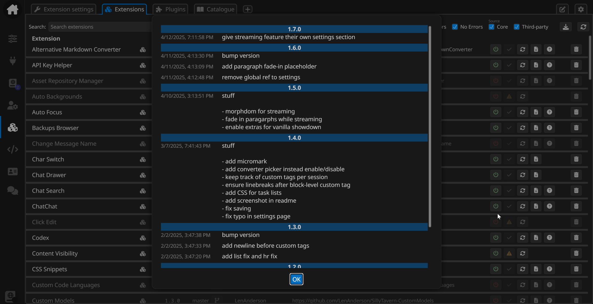
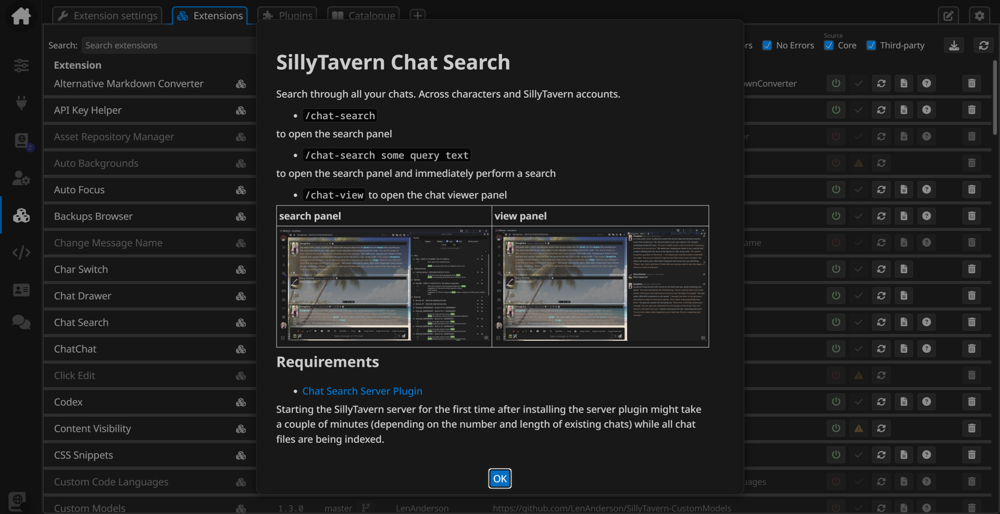
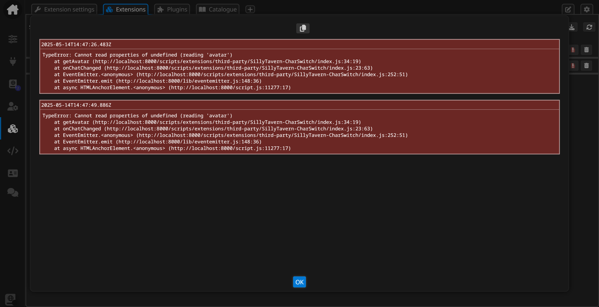
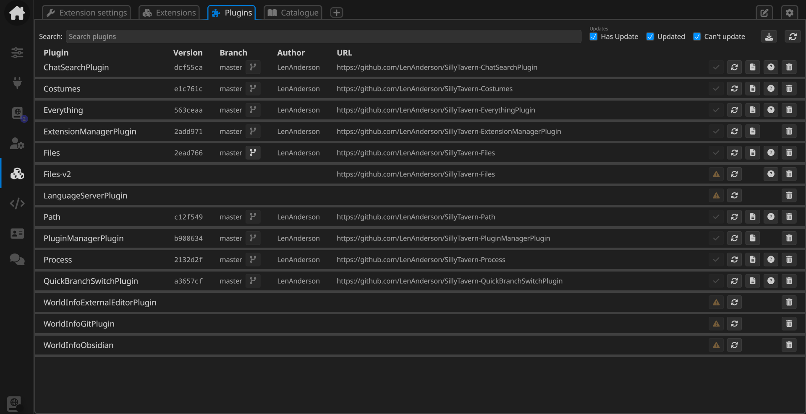
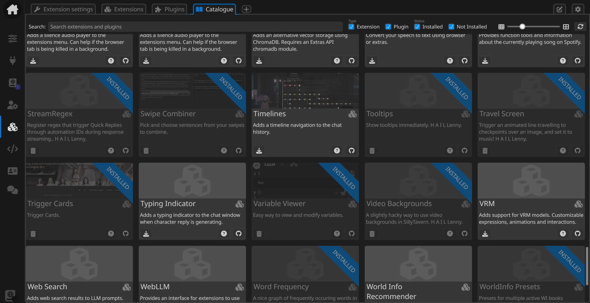
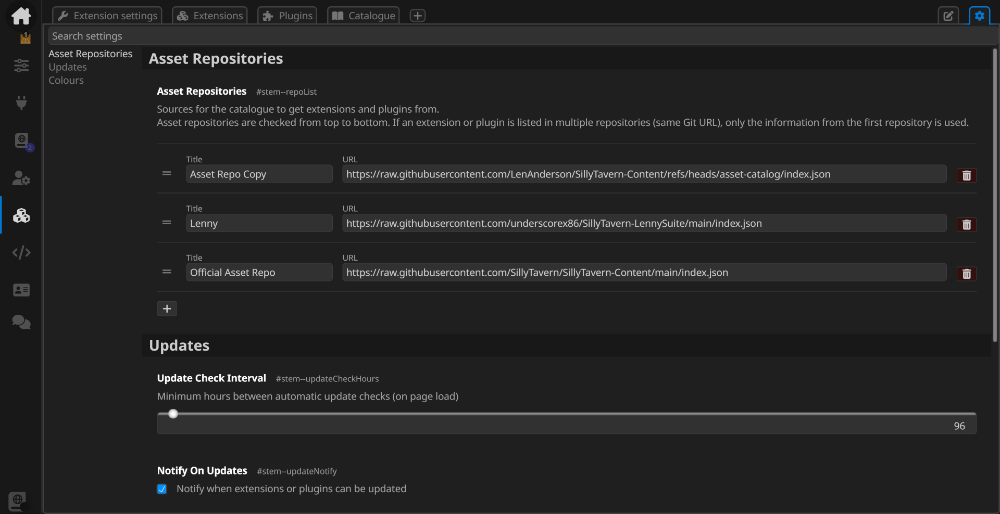
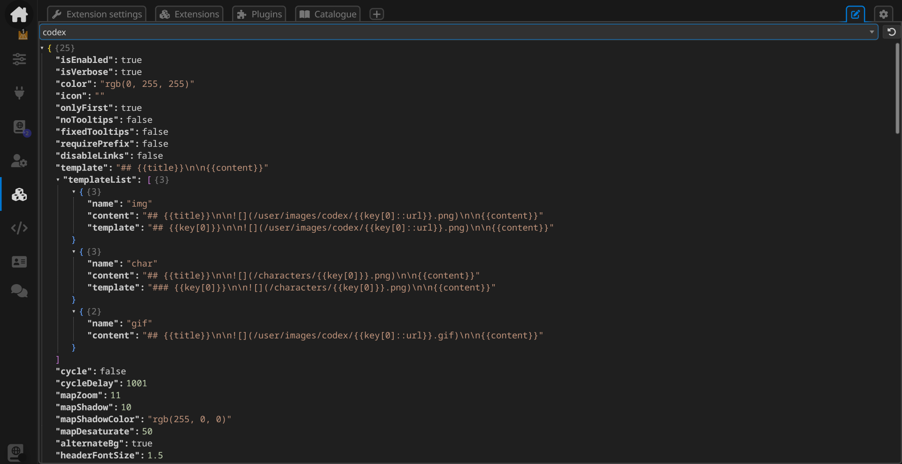

# SillyTavern - Extension Manager

Extension settings, management of installed extensions and plugins, and extension and plugin catalogue in a tabbed view right in the extension drawer.

|  |  |  |
|--|--|--|
| **Extension Settings** |  |
| **Extensions** | Filterable list of installed extensions | Switching between branches |
|  |  |  |
|  | Extension change logs | Extension readme |
|  |  |  |
|  | Extension error logs |  |
|  |  |  |
| **Server Plugins** | Filterable list of installed server plugins |  |
|  |  |  |
| **Catalogue** | Browse offical and third-party asset lists |  |
|  |  |  |
| **Settings JSON** | View raw extension settings |  |
|  |  |  |

## Requirements
- [Extension Manager Server Plugin](https://github.com/LenAnderson/SillyTavern-ExtensionManagerPlugin)
